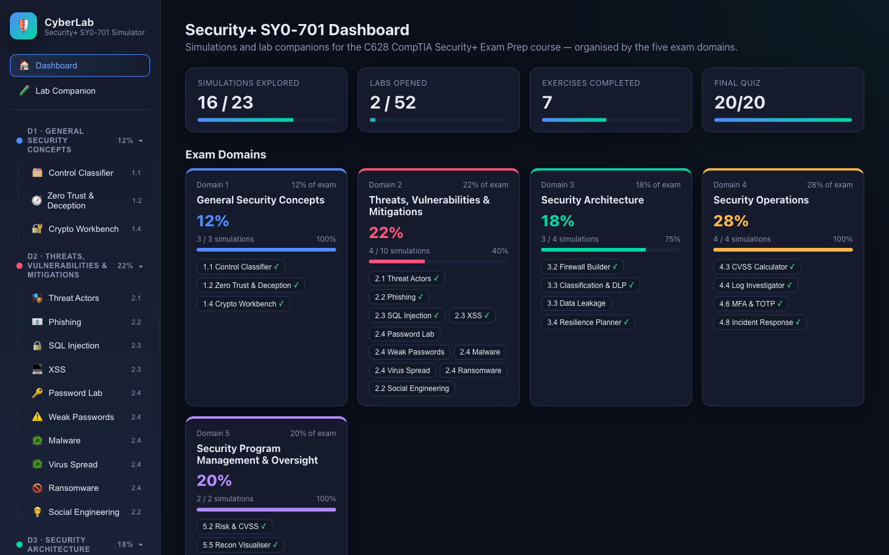

<div align="center">

# CyberLab — Security+ SY0-701 Simulator

[](https://developer.mozilla.org/en-US/docs/Web/HTML)
[](https://developer.mozilla.org/en-US/docs/Web/CSS)
[](https://developer.mozilla.org/en-US/docs/Web/JavaScript)
[](https://opensource.org/licenses/MIT)

**A safe, browser-only lab that mirrors the 52 hands-on labs of the C628 CompTIA Security+ (SY0-701) Exam Prep course, organised around the five exam domains.**

[Live Demo](https://alfredang.github.io/cybersecuritysimulator/) · [C628 Course Labs](https://github.com/tertiarycourses/C628-CompTIA-SecurityPlus-Exam-Prep) · [Report Bug](https://github.com/alfredang/cybersecuritysimulator/issues)

</div>

## Screenshot



## About

**CyberLab** is a purely educational, single-page web app that lets learners explore the concepts behind the CompTIA Security+ **SY0-701** exam through interactive simulations — and then jump into the matching hands-on lab from the **C628 CompTIA Security+ Exam Prep** course.

Every "attack" is a controlled visualization built from fictional data. There is **no backend, no database, no network calls, and no executable payloads**. The only cryptography that runs is the browser's own **Web Crypto API**, used locally for teaching (hashing, AES-GCM, HMAC/TOTP) — nothing ever leaves your browser.

The app is structured around the five SY0-701 domains and their exam weightings:

| # | Domain | Weight |
|---|--------|--------|
| 1 | General Security Concepts | 12% |
| 2 | Threats, Vulnerabilities & Mitigations | 22% |
| 3 | Security Architecture | 18% |
| 4 | Security Operations | 28% |
| 5 | Security Program Management & Oversight | 20% |

## Features by domain

Each simulation shows *what it is*, an interactive exercise with feedback, warning signs and defences, and a **"Practise in Lab NN"** chip that links to the real course lab on GitHub plus an in-app **Lab Companion**.

### Domain 1 — General Security Concepts
| Simulation | Objective | Labs |
|---|---|---|
| **Control Classifier** — sort 12 controls by category × type | 1.1 | 01 |
| **Zero Trust & Deception** — PDP/PEP access decisions + honeytoken tripwire | 1.2 | 02, 03 |
| **Crypto Workbench** — live SHA hashing & avalanche, salting, AES-256-GCM round trip (PBKDF2), toy RSA signatures, certificate-chain validator | 1.4 | 05, 06, 07 |

### Domain 2 — Threats, Vulnerabilities & Mitigations
| Simulation | Objective | Labs |
|---|---|---|
| **Threat Actor Profiler** — match scenarios to actor & motivation | 2.1 | 08 |
| **Phishing Simulator** — 19 fictional emails, annotated walkthrough, URL inspector | 2.2 | 09, 52 |
| **Social Engineering Trainer** — 12 scenarios across 8 tactics | 2.2 | 09, 52 |
| **SQL Injection** — mock in-memory login (never a real DB) | 2.3 | 10 |
| **XSS Simulator** — unsafe vs escaped output, side by side | 2.3 | 11 |
| **Password Lab** / **Weak Passwords** — entropy & crack-time | 2.4 | 13 |
| **Malware / Virus / Ransomware** — animated, clearly-labelled demos | 2.4 | 14 |

### Domain 3 — Security Architecture
| Simulation | Objective | Labs |
|---|---|---|
| **Firewall Rule Builder** — ordered ACLs, first-match, implicit deny, segmentation zones, WAF check | 3.2 | 19, 20, 21 |
| **Data Classification & DLP** — detect NRIC, Luhn-valid cards & emails; mask / tokenise / redact | 3.3 | 23 |
| **Data Leakage Estimator** — practices → leak-risk score | 3.3 | 23 |
| **Resilience Planner** — RAID 0/1/5/6/10 capacity & fault-tolerance calculator, RPO/RTO & 3-2-1 checker, backup-set chooser | 3.4 | 26, 27 |

### Domain 4 — Security Operations
| Simulation | Objective | Labs |
|---|---|---|
| **CVSS v3.1 Calculator** — official base-score formula + vuln-management prioritisation | 4.3 | 31, 32 |
| **Log Investigator** — filter fictional auth/web logs, answer questions, build a timeline | 4.4 / 4.9 | 33, 44 |
| **MFA & TOTP** — real RFC 6238 TOTP via Web Crypto HMAC-SHA1, factor classifier | 4.6 | 38, 39 |
| **Incident Response** — order the IR phases & the order of volatility | 4.8 | 41, 42 |

### Domain 5 — Security Program Management & Oversight
| Simulation | Objective | Labs |
|---|---|---|
| **Risk Calculator & Register** — SLE/ALE, control cost-benefit, 5×5 heat map | 5.2 | 46 |
| **Recon Visualiser** — SYN vs connect scans, fictional port-scan results, passive vs active | 5.5 | 49, 50 |

### Across the app
- **Dashboard** with the five domains, their weightings, per-domain progress, and an **objective → lab map** (52 labs).
- **Lab Companion** — for any of the 52 labs: title, objective, domain, steps (instruction + styled terminal block with a copy button) and verification, plus a link to the GitHub lab.
- **Final Quiz** — 20 SY0-701-style questions spread across the five domains, with a printable certificate at 70%+.
- Light/dark theme, collapsible sidebar, mobile menu, and `localStorage` progress — all accessible (focus states, labels, skip link).

## How it maps to the C628 labs

The simulations are the "safe sandbox" first half; the **C628 CompTIA Security+ Exam Prep** labs are the real hands-on second half, run on the free Killercoda Ubuntu Playground.

- Course & labs: **https://github.com/tertiarycourses/C628-CompTIA-SecurityPlus-Exam-Prep**
- The 52 labs are defined in [`labs.js`](labs.js) as `window.LABS = [{ num, slug, domain, obj, title, objective, desc, build, services, mins, steps:[{t, cmd}], test }]`. The step/verification text ships as short placeholders; the course coordinator regenerates `labs.js` from the course data files with the full steps. The schema is stable, so the UI needs no changes when it is regenerated.
- Lab URLs follow `…/C628-CompTIA-SecurityPlus-Exam-Prep/tree/main/labs/lab-NN-slug`.

## Safety promise

- No real malware, viruses, or exploit code
- No live phishing pages or credential harvesting
- No backend, no database, **no external network calls**
- Real cryptography runs **only locally** via the Web Crypto API (hashing, AES-GCM, HMAC/TOTP) for teaching — keys and data never leave the browser
- All names, emails, IPs, NRICs and card numbers are fictional (documentation ranges / well-known test values)
- Pure HTML / CSS / vanilla JavaScript — runs entirely in the browser

## Tech Stack

| Category | Technology |
|---|---|
| Markup | HTML5 |
| Styling | CSS3 (custom properties, grid, flexbox) — no framework |
| Logic | Vanilla JavaScript (ES6+) — no libraries |
| Crypto | Browser-native Web Crypto API (local only) |
| Persistence | Browser `localStorage` |
| Hosting | GitHub Pages (static) |

Total dependencies: **zero**.

## Project Structure

```
cybersecuritysimulator/
├── index.html         # Single-page app shell: dashboard, companion, 23 simulations, quiz
├── style.css          # Theming, layout, components, responsive & print rules
├── script.js          # All interactive logic (modules, labs, quiz, state)
├── labs.js            # window.LABS — the 52 C628 labs (regenerated by the course)
├── screenshot.png     # README preview image (1440×900 dashboard)
└── README.md          # You are here
```

## Getting Started

Any modern web browser is all you need.

```bash
git clone https://github.com/alfredang/cybersecuritysimulator.git
cd cybersecuritysimulator

# Recommended: serve over http (Web Crypto needs a secure/localhost context)
python3 -m http.server 8000
# then open http://localhost:8000
```

## Deployment

This repository deploys automatically to **GitHub Pages** on every push to `main` via `.github/workflows/deploy.yml`.

Live URL: **https://alfredang.github.io/cybersecuritysimulator/**

Because the app is pure static HTML/CSS/JS, the four files also drop onto Netlify, Vercel, Cloudflare Pages, S3+CloudFront, or any plain web server.

## Educational Use

- Pre-work / flipped-classroom warm-up before the C628 hands-on labs
- Security+ SY0-701 exam-prep revision by domain
- Corporate or academic security-awareness training
- Workshops and live demonstrations

## Developed By

**[Tertiary Infotech Academy Pte Ltd](https://www.tertiarycourses.com.sg)** — Singapore-based provider of professional IT and cybersecurity training.

## Acknowledgements

- Structured on the **CompTIA Security+ SY0-701** exam objectives and the **C628 CompTIA Security+ Exam Prep** lab catalogue
- Concepts informed by **OWASP**, **NIST** and **MITRE ATT&CK** public guidance
- CVSS base-score formula per **FIRST CVSS v3.1**; TOTP per **RFC 6238**
- Built with the assistance of **Claude Code**

> CompTIA and Security+ are trademarks of CompTIA, Inc. This is an independent training aid and is not affiliated with or endorsed by CompTIA.

---

<div align="center">

If this project helped you learn something new, please star the repo.

</div>
